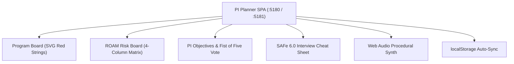

# 🚂 PI Planner — SAFe® 6.0 Program Increment & Dependency Board

**Engineered by Balaji Palani** (Senior Scrum Master / Technical Agile Delivery Lead, CSM®, SAFe® 6 SSM)  
**Repository:** [github.com/layyzee/PIPlanner](https://github.com/layyzee/PIPlanner)  
**Local Workspace:** [`/Users/layyzee/Downloads/PIPlanner`](file:///Users/layyzee/Downloads/PIPlanner)  
**Live Local Server:** `http://localhost:5181`

---

## 📸 Production Verification Gallery

````carousel

<!-- slide -->

<!-- slide -->

<!-- slide -->

````

---

## 🌟 What Was Built

### 1. Interactive Multi-Team Program Board ([`ProgramBoard.jsx`](file:///Users/layyzee/Downloads/PIPlanner/src/components/ProgramBoard.jsx))
* **4 Enterprise Squad Swimlanes:** Mobile Client Squad, Payments & Billing Gateway, Core Platform & APIs, Cloud Infra & SRE.
* **5 Sprints across the PI:** Sprints 1 to 4 for feature delivery, plus Sprint 5 dedicated to the **Innovation & Planning (IP) Sprint** highlighted in gold.
* **Interactive Red Dependency Strings:** Dynamic SVG Bézier curves connecting blocking deliverables. Clicking any red string or node triggers acoustic feedback and opens the cross-team blocker details.

### 2. Built-in SAFe® 6.0 Interview Cheat Sheet ([`SafeExplainerDrawer.jsx`](file:///Users/layyzee/Downloads/PIPlanner/src/components/SafeExplainerDrawer.jsx))
* Designed specifically for Balaji to reference before and during interviews.
* Includes all 8 core SAFe dimensions (ART, PI, PI Planning, IP Sprint, Dependencies, ROAM, SoS, Fist of Five).
* Features an exact **"💡 How to say it in an interview"** card for each concept with word-for-word talking points.

### 3. Interactive ROAM Risk Governance Board ([`RoamRiskBoard.jsx`](file:///Users/layyzee/Downloads/PIPlanner/src/components/RoamRiskBoard.jsx))
* 4-column governance matrix:
  * **R – Resolved (Green):** Addressed and eliminated from the plan.
  * **O – Owned (Indigo):** Assigned to an accountable individual.
  * **A – Accepted (Amber):** Acknowledged unavoidable operational reality.
  * **M – Mitigated (Purple):** Contingency plan formulated.
* Includes 1-click column movers and new risk creation.

### 4. PI Objectives & Fist of Five Confidence Vote ([`PiObjectivesTab.jsx`](file:///Users/layyzee/Downloads/PIPlanner/src/components/PiObjectivesTab.jsx))
* Clearly separates **Committed Objectives** from **Uncommitted Objectives** (protects predictability while preserving business value).
* Interactive 1-to-5 star/finger confidence dial with automated ART average calculation and celebration confetti.

### 5. Recruiter 1-Click Sandbox Dock ([`RecruiterSandboxDock.jsx`](file:///Users/layyzee/Downloads/PIPlanner/src/components/RecruiterSandboxDock.jsx))
* `Highlight Critical Path`: Illuminates all cross-team blocking dependencies.
* `Simulate Conflict`: Demonstrates how a Scrum Master flags scheduling inversions (downstream story scheduled before upstream enabler).
* `Simulate Vote`: Simulates team all-hands consensus reaching 4.6/5.0.
* `Jira CSV & Copy MD`: Instant export for enterprise Jira / Confluence documentation.

---

## 🏗️ Technical Architecture & Zero-Cost Cloud Ready



* **Zero-Cost Footprint:** Deployed locally at `http://localhost:5181` and ready for Render free tier deployment via [`render.yaml`](file:///Users/layyzee/Downloads/PIPlanner/render.yaml).
* **GitHub Repository:** Published at [github.com/layyzee/PIPlanner](https://github.com/layyzee/PIPlanner).
